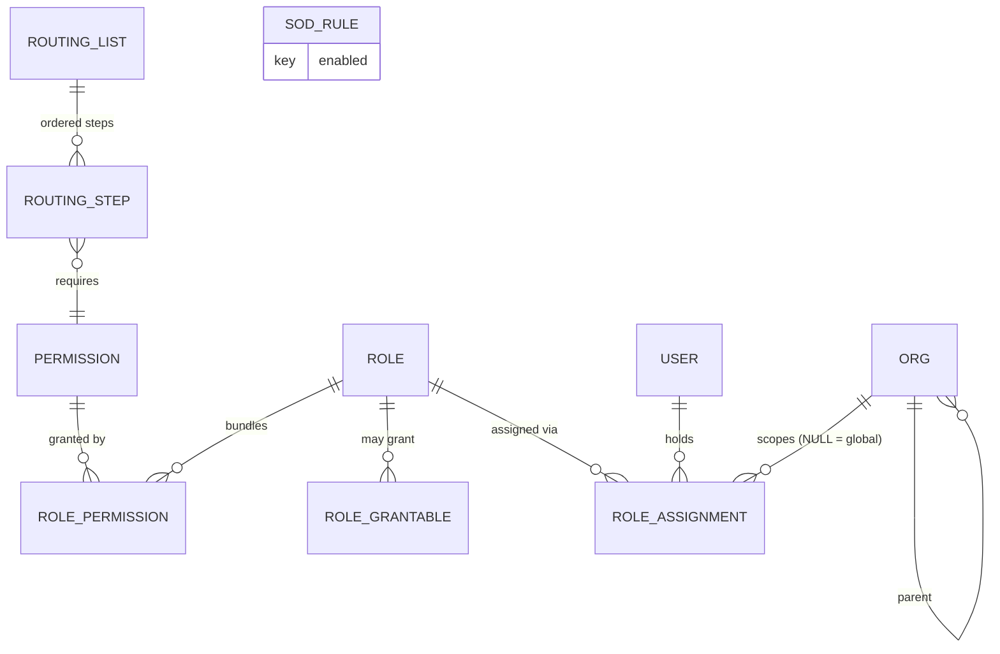

# Permission system & RBAC map

Everything in this document is editable at runtime from **Administration**, without code changes, except the
list of *system* permission keys, which are the checkpoints enforced in code.

## 1. Model



| Concept | What it is | Where to edit |
|---|---|---|
| **Permission** | Atomic capability such as `workflow.approve`. System keys are enforced in code. Custom keys can be added and used on routing steps. | Admin › Permission catalog |
| **Role** | Named bundle of permissions. Built-in roles are just seeds and can be edited, cloned or deleted. | Admin › Roles, or Permission matrix |
| **Role assignment** | User + role + **scope** (an org, optionally including sub-orgs, or global) + optional **expiry**. | Admin › Users › user › Role assignments |
| **Delegated grant** | "Holders of role A may grant role B", so admins can appoint officials without holding those powers. | Role editor › Roles this role may grant |
| **SoD rule** | Toggleable conflict-of-interest constraint applied on top of permissions. | Admin › Separation of duties |
| **Routing step** | Workflow step that requires a permission, optionally pinned to one person and limited to certain document types. | Admin › Routing lists |
| **Policy file** | JSON export/import of roles, custom permissions, delegated grants and SoD flags. | Admin › Import / export policy |

## 2. How a check is evaluated

```
has_perm(user, key, org) =
    user.active
    AND EXISTS assignment a OF user
        WHERE (a.expires_at IS NULL OR a.expires_at >= today)
          AND key IN permissions(a.role)
          AND ( a.org IS NULL                          -- global
             OR a.org = org                            -- exact org
             OR (a.include_children AND a.org IN ancestors(org)) )
```

* `org = None` asks "does the user hold this anywhere?". It is used for showing menus. Every action re-checks with
  the target record's org.
* Permissions are **additive** (union of all active assignments). There are no deny rules; use SoD rules for
  prohibitions.
* Results are cached per request (`g._grant_cache`) and cleared after any RBAC change.

**Document access** ([app/views/_util.py](../app/views/_util.py))

| Action | Allowed when |
|---|---|
| View | traveler is me + `document.view.self` · OR `document.view.org` on doc org · OR I can act on the current step · OR I previously acted on it |
| Edit | status CREATED/RETURNED AND (mine + `document.edit.self` OR `document.edit.others` on doc org) |
| Sign | status CREATED/RETURNED AND (mine + `document.sign.self` OR not mine + `document.sign.others`) |
| Stamp / Return | step's `required_permission` on doc org, step assignee (if any) is me, no SoD violation; Return also needs `workflow.return` |
| Override | `workflow.override` on doc org (remarks mandatory) |
| Cancel / Amend | `document.cancel` / `document.amend`, and mine or `document.edit.others` |

**Role assignment** ([app/rbac.py](../app/rbac.py) `can_assign`)

1. Granter has `admin.assign` covering the target scope.
2. `no_self_assign`: granter ≠ grantee.
3. `no_escalation`: either one of the granter's in-scope roles lists the target role as **grantable**, or the granter
   holds **every** permission of the target role in that scope.
4. Only globally scoped assigners can create global assignments.

## 3. Separation-of-duties rules

| Key | Rule | Default |
|---|---|---|
| `no_self_approve` | Cannot stamp a document where you are the traveler | On |
| `no_preparer_approve` | Cannot stamp a document you created | On |
| `distinct_approver_certifier` | Same person cannot both APPROVE and CERTIFY one document (since its last return or amendment) | On |
| `no_escalation` | Cannot grant permissions you don't hold (unless delegated) | On |
| `no_self_assign` | Cannot grant roles to yourself | On |

To add a new rule: add it to `SOD_RULES` in `rbac.py`, then check `rbac.sod_enabled("<key>")` where it applies.

## 4. Permission catalog and default roles

Legend: TRV Traveler · PREP Preparer/NDEA · REV Reviewer · AO Approving Official · CO Certifying Officer ·
BUD Budget DTA · RTE Routing List Manager · ODTA Organizational DTA · DEBT Debt Monitor · AUD Auditor · SYS System Admin

| Permission | TRV | PREP | REV | AO | CO | BUD | RTE | ODTA | DEBT | AUD | SYS |
|---|:-:|:-:|:-:|:-:|:-:|:-:|:-:|:-:|:-:|:-:|:-:|
| `document.create.self` | ✓ | ✓ |  |  |  |  |  |  |  |  | ✓ |
| `document.create.others` |  | ✓ |  |  |  |  |  |  |  |  | ✓ |
| `document.view.self` | ✓ | ✓ |  |  |  |  |  |  |  |  | ✓ |
| `document.view.org` |  | ✓ | ✓ | ✓ | ✓ | ✓ | ✓ | ✓ | ✓ | ✓ | ✓ |
| `document.edit.self` | ✓ | ✓ |  |  |  |  |  |  |  |  | ✓ |
| `document.edit.others` |  | ✓ |  |  |  |  |  |  |  |  | ✓ |
| `document.sign.self` | ✓ | ✓ |  |  |  |  |  |  |  |  | ✓ |
| `document.sign.others` |  | ✓ |  |  |  |  |  |  |  |  | ✓ |
| `document.cancel` | ✓ | ✓ |  |  |  |  |  |  |  |  | ✓ |
| `document.amend` | ✓ | ✓ |  |  |  |  |  |  |  |  | ✓ |
| `workflow.review` |  |  | ✓ |  |  |  |  |  |  |  | ✓ |
| `workflow.approve` |  |  |  | ✓ |  |  |  |  |  |  | ✓ |
| `workflow.certify` |  |  |  |  | ✓ |  |  |  |  |  | ✓ |
| `workflow.budget` |  |  |  |  |  | ✓ |  |  |  |  | ✓ |
| `workflow.return` |  |  | ✓ | ✓ | ✓ | ✓ |  |  |  |  | ✓ |
| `workflow.override` |  |  |  |  |  |  |  | ✓ |  |  | ✓ |
| `profile.edit.self` | ✓ | ✓ |  |  |  |  |  |  |  |  | ✓ |
| `profile.view.org` |  | ✓ |  |  |  |  |  | ✓ |  | ✓ | ✓ |
| `profile.edit.org` |  |  |  |  |  |  |  | ✓ |  |  | ✓ |
| `routing.manage` |  |  |  |  |  |  | ✓ | ✓ |  |  | ✓ |
| `org.manage` |  |  |  |  |  |  |  | ✓ |  |  | ✓ |
| `loa.view` |  |  |  | ✓ | ✓ | ✓ |  | ✓ |  | ✓ | ✓ |
| `loa.manage` |  |  |  |  |  | ✓ |  |  |  |  | ✓ |
| `perdiem.manage` |  |  |  |  |  |  |  |  |  |  | ✓ |
| `debt.manage` |  |  |  |  |  |  |  |  | ✓ |  | ✓ |
| `reports.view` |  |  |  | ✓ |  | ✓ |  | ✓ | ✓ | ✓ | ✓ |
| `reports.export` |  |  |  |  |  | ✓ |  | ✓ |  | ✓ | ✓ |
| `audit.view` |  |  |  |  |  |  |  |  |  | ✓ | ✓ |
| `admin.users` |  |  |  |  |  |  |  | ✓ |  |  | ✓ |
| `admin.roles` |  |  |  |  |  |  |  |  |  |  | ✓ |
| `admin.assign` |  |  |  |  |  |  |  | ✓ |  |  | ✓ |
| `admin.sod` |  |  |  |  |  |  |  |  |  |  | ✓ |
| `admin.policy_io` |  |  |  |  |  |  |  |  |  |  | ✓ |
| `admin.settings` |  |  |  |  |  |  |  |  |  |  | ✓ |

Default delegated grants: **ODTA** may grant Traveler, Preparer, Reviewer, AO, CO, Budget DTA, Routing List Manager,
Debt Monitor and Auditor. It may not grant System Admin or another ODTA.

## 5. Mapping from DTS permission levels

| DTS level | Meaning in DTS | Equivalent here |
|---|---|---|
| 0 | Create/sign own documents | Traveler role |
| 0 + NDEA | Act for travelers without access | Preparer role (`document.*.others`) |
| 1 | Reports | `reports.view` (+ `reports.export`) |
| 2 | Approve/review/certify | Reviewer / AO / CO roles (`workflow.*`) |
| 3 | Budgets | Budget DTA role (`loa.manage`, `workflow.budget`) |
| 4 | Non-DTS transactions | Not yet implemented |
| 5 | Routing lists and org maintenance | Routing List Manager (`routing.manage`, `org.manage`) |
| 6 | Traveler profiles | `profile.view.org`, `profile.edit.org` |
| Org access | Which orgs a DTA controls | Assignment **scope** + include sub-orgs |
| Group access | Which travelers a preparer serves | Assignment scope on `document.*.others` |

Unlike DTS levels, permissions here are independent. For example, you can give reports without profile access, or
create an "Alternate AO" role that expires on a set date.

## 6. Common customization recipes

* **Alternate AO for leave coverage**: grant *Approving Official* scoped to the squadron with an expiry date.
* **Supervisor pre-review**: add a routing step at order 1 requiring `workflow.review`, applied to authorizations only.
* **Special waiver review**: create the custom permission `custom.waiver_review`, add it to a new "Waiver Board" role,
  and add a routing step requiring it.
* **Read-only IG inspector**: clone *Auditor*, remove `reports.export`, and assign globally with an expiry.
* **Promote policy between environments**: export from test, review the JSON diff in Git, then import into production.

## 7. Policy file format

```json
{
  "version": 1,
  "custom_permissions": [{"key": "custom.waiver_review", "name": "Waiver review", "category": "Custom", "description": ""}],
  "roles": [
    {"key": "alt_ao", "name": "Alternate AO", "description": "", "legacy_level": "Level 2",
     "permissions": ["document.view.org", "workflow.approve", "workflow.return"], "can_grant": []}
  ],
  "sod_rules": {"no_self_approve": true, "distinct_approver_certifier": true}
}
```

Import upserts by `key`. **Delete roles not in file** makes the file authoritative. Unknown permission keys reject
the whole import (it is all-or-nothing).

## 8. Roadmap / extension points

| Next step | Approach |
|---|---|
| CAC/PIV sign-in | Replace `/login` with SAML/OIDC (for example via the DoD identity provider). Map the EDIPI to `users.username`. Optionally map IdP groups to role assignments. |
| Attribute conditions (ABAC) | Add `conditions` JSON to `role_assignments` (for example `{"max_amount": 5000, "doc_types": ["LOCAL"]}`) and evaluate it in `workflow.can_act`. |
| Dollar-threshold routing | Add `min_amount` / `max_amount` to `routing_steps` and filter in `workflow.steps_for`. |
| Explicit deny | Add an `effect` column (`allow`/`deny`) to `role_permissions`. Deny wins in `has_perm`. |
| Access recertification | Periodic report of assignments with no expiry, plus a review workflow. |
